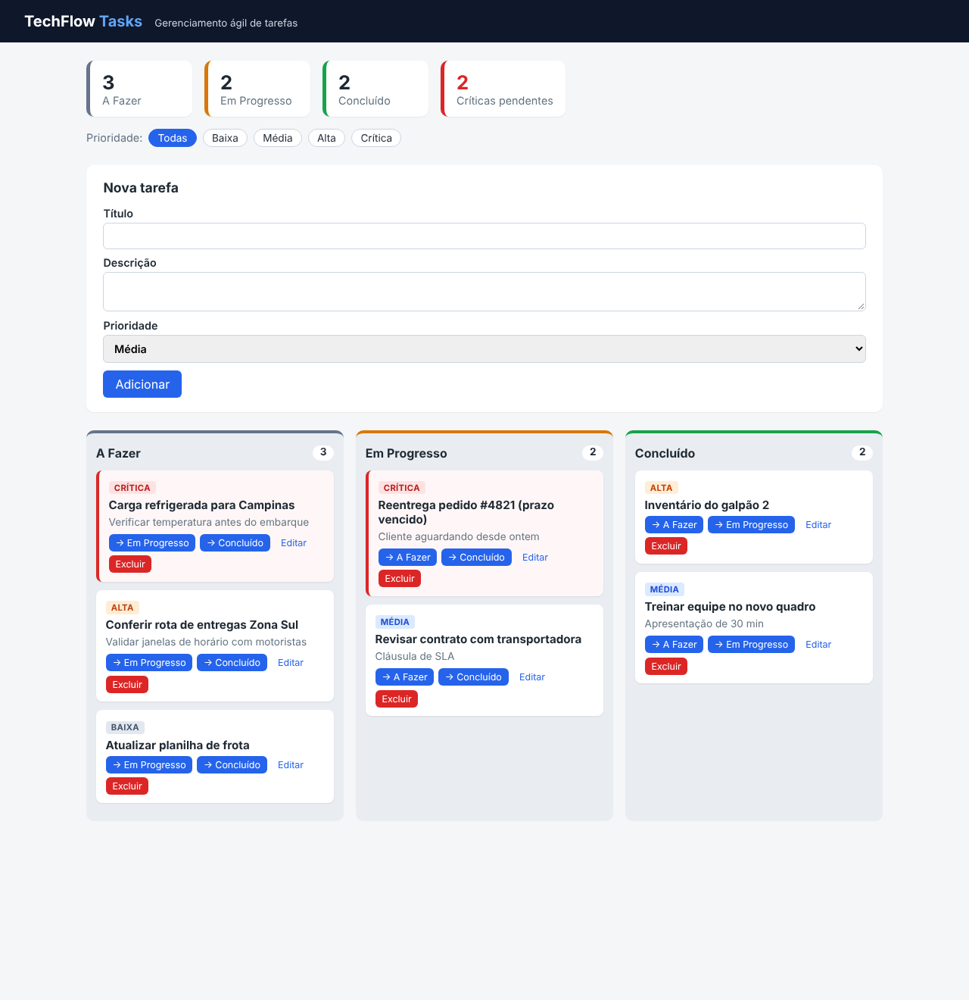

# TechFlow Tasks


Sistema web de gerenciamento de tarefas baseado em metodologias ágeis, desenvolvido pela
**TechFlow Solutions** (empresa fictícia) para uma startup de logística.



## 1. Objetivo

O cliente precisa acompanhar o fluxo de trabalho da equipe em tempo real, priorizar tarefas
críticas e monitorar o desempenho do time. O objetivo deste projeto é entregar um sistema web
simples, testado e com integração contínua que sirva de base para essas necessidades.

## 2. Escopo inicial

| Incluído no escopo (versão 1.0)                                  | Fora do escopo                   |
|------------------------------------------------------------------|----------------------------------|
| CRUD de tarefas (criar, listar, editar e excluir)                | Autenticação de usuários         |
| Status da tarefa: **A Fazer**, **Em Progresso** e **Concluído**  | Notificações por e-mail          |
| Filtro de tarefas por status                                     | Integração com sistemas externos |
| Painel com contagem de tarefas por status                        | Aplicativo mobile                |
| API REST em JSON para integração                                 |                                  |
| Validação de entradas e testes automatizados                     |                                  |
| Pipeline de CI com GitHub Actions                                |                                  |

## 3. Metodologia

O projeto adota uma abordagem **híbrida Scrum + Kanban (Scrumban)**:

- **Kanban (GitHub Projects):** todo o trabalho é representado em cards no quadro com as
  colunas **A Fazer (To Do)**, **Em Progresso (In Progress)** e **Concluído (Done)**.
  Um limite de WIP (*Work In Progress*) de 2 cards em "Em Progresso" evita acúmulo de
  trabalho inacabado.
- **Scrum (cadência):** o trabalho foi dividido em *sprints* curtas com um objetivo claro:
  - *Sprint 1* – estrutura do repositório, modelo de dados e validação;
  - *Sprint 2* – persistência, API REST e interface web;
  - *Sprint 3* – qualidade (testes + CI) e mudança de escopo.
- **Commits semânticos** ([Conventional Commits](https://www.conventionalcommits.org/)):
  `feat`, `fix`, `test`, `docs`, `ci`, `chore`, `refactor`.
- **Qualidade contínua:** cada *push* e *pull request* dispara o pipeline do GitHub Actions,
  que valida o estilo do código (flake8) e executa os testes (pytest).

## 4. Tecnologias

| Camada                  | Ferramenta                         |
|-------------------------|------------------------------------|
| Linguagem               | Python 3.11+                       |
| Framework web           | Flask 3                            |
| Banco de dados          | SQLite (biblioteca padrão)         |
| Testes automatizados    | pytest + pytest-cov                |
| Qualidade de código     | flake8                             |
| Integração contínua     | GitHub Actions                     |
| Gestão do trabalho      | GitHub Projects (Kanban) + Issues  |

## 5. Estrutura de diretórios

```
techflow-tasks/
├── .github/workflows/ci.yml   # pipeline de integração contínua
├── docs/                      # diagramas UML, quadro Kanban e materiais de apoio
├── src/
│   ├── app.py                 # aplicação Flask (rotas web e API REST)
│   ├── models.py              # entidade Task e regras de validação
│   ├── repository.py          # persistência em SQLite (CRUD)
│   ├── templates/             # páginas HTML (Jinja2)
│   └── static/style.css       # estilos da interface
├── tests/                     # testes automatizados (pytest)
├── requirements.txt           # dependências de execução
├── requirements-dev.txt       # dependências de desenvolvimento/testes
└── .flake8                    # configuração do flake8
```

## 6. Como executar

Pré-requisito: Python 3.11 ou superior.

```bash
# 1. Clonar o repositório
git clone https://github.com/almeidamurilo166-stack/techflow-tasks.git
cd techflow-tasks

# 2. Criar e ativar um ambiente virtual
python -m venv .venv
source .venv/bin/activate        # Windows: .venv\Scripts\activate

# 3. Instalar as dependências
pip install -r requirements-dev.txt

# 4. Iniciar o servidor
flask --app src.app run --debug
```

Acesse **http://127.0.0.1:5000** no navegador. O banco `techflow.db` é criado
automaticamente na primeira execução (o caminho pode ser alterado pela variável de ambiente
`TECHFLOW_DB`).

## 7. Testes e qualidade

```bash
pytest                                   # executa todos os testes
pytest --cov=src --cov-report=term-missing   # testes + relatório de cobertura
flake8 src tests                         # verificação de estilo
```

Os testes estão organizados em três níveis:

- `tests/test_models.py` – **unitários**: validação de entradas (título obrigatório,
  limites de tamanho, status válidos).
- `tests/test_repository.py` – **persistência**: operações CRUD no SQLite.
- `tests/test_api.py` e `tests/test_web.py` – **integração**: requisições HTTP reais à
  API REST e às páginas, incluindo os cenários de erro (400 e 404).

O pipeline em `.github/workflows/ci.yml` executa o **flake8** e, se ele passar, roda o
**pytest** em Python 3.11 e 3.12, exigindo **cobertura mínima de 80%**. Um *push* com teste
quebrado ou código fora do padrão fica marcado em vermelho na aba **Actions**.

## 8. API REST

| Método | Rota                | Descrição                                   |
|--------|---------------------|---------------------------------------------|
| GET    | `/api/health`       | Verifica se a aplicação está no ar          |
| GET    | `/api/tasks`        | Lista tarefas (filtros `?status=` e `?priority=`)|
| POST   | `/api/tasks`        | Cria uma tarefa                             |
| GET    | `/api/tasks/<id>`   | Detalha uma tarefa                          |
| PUT    | `/api/tasks/<id>`   | Atualiza campos de uma tarefa               |
| DELETE | `/api/tasks/<id>`   | Exclui uma tarefa                           |

Valores de `status`: `todo` (A Fazer), `doing` (Em Progresso), `done` (Concluído).

Exemplo:

```bash
curl -X POST http://127.0.0.1:5000/api/tasks \
     -H "Content-Type: application/json" \
     -d '{"title": "Conferir rota de entregas", "description": "Zona Sul"}'
```

## 9. Gestão de mudanças

### Mudança de escopo nº 1 — Prioridade das tarefas (versão 1.1)

**Solicitação.** Na revisão da Sprint 2 o cliente usou o quadro com tarefas reais da
operação e relatou que entregas urgentes (cargas perecíveis, reentregas com prazo vencido)
ficavam misturadas com tarefas de rotina. O briefing original já pedia
"priorizar tarefas críticas", mas essa necessidade não tinha entrado no escopo da versão 1.0.

**Justificativa.** Sem prioridade, a equipe precisa ler todos os cards para descobrir o que
é urgente, o que aumenta o risco de atrasos — justamente o problema que o sistema deveria
resolver. Como o Manifesto Ágil valoriza *responder a mudanças mais que seguir um plano*,
a mudança foi aceita e encaixada na Sprint 3, no lugar de melhorias visuais de menor valor,
mantendo o prazo da entrega.

**O que muda.**

| Item                | Antes (v1.0)                         | Depois (v1.1)                                         |
|---------------------|--------------------------------------|-------------------------------------------------------|
| Campo `priority`    | não existia                          | `low`, `medium` (padrão), `high`, `critical`          |
| Ordenação dos cards | mais recentes primeiro               | maior prioridade primeiro; depois, mais recentes      |
| Filtros             | por status                           | por status **e** por prioridade (web e API)           |
| Painel              | contagem por status                  | + contador de tarefas **críticas pendentes**          |
| Visual              | cards iguais                         | etiqueta colorida; cards críticos destacados em vermelho |

**Análise de impacto.** `models.py` (nova regra de validação), `repository.py` (nova coluna,
migração automática de bancos antigos com `ALTER TABLE`), `app.py` (filtro), templates,
README e novos testes. A API continua compatível: quem não envia `priority` recebe
`medium` por padrão.

**Atualização do Kanban.** Foi criado o card *"Mudança de escopo: prioridade de tarefas"*,
que passou por **A Fazer → Em Progresso → Concluído**, e o card *"Ajustes visuais do
cabeçalho"* foi devolvido ao *backlog* para abrir espaço na sprint.

## 10. Documentação complementar

- [Diagramas UML](docs/img/) — casos de uso e classes
- [Quadro Kanban](docs/kanban.md) — cards, sprints e evolução da mudança de escopo

